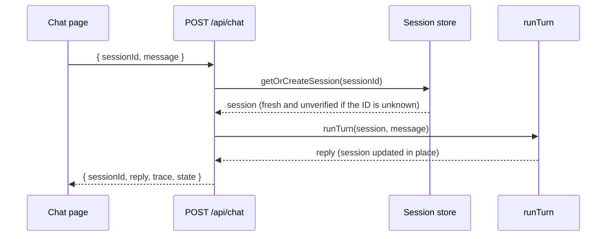
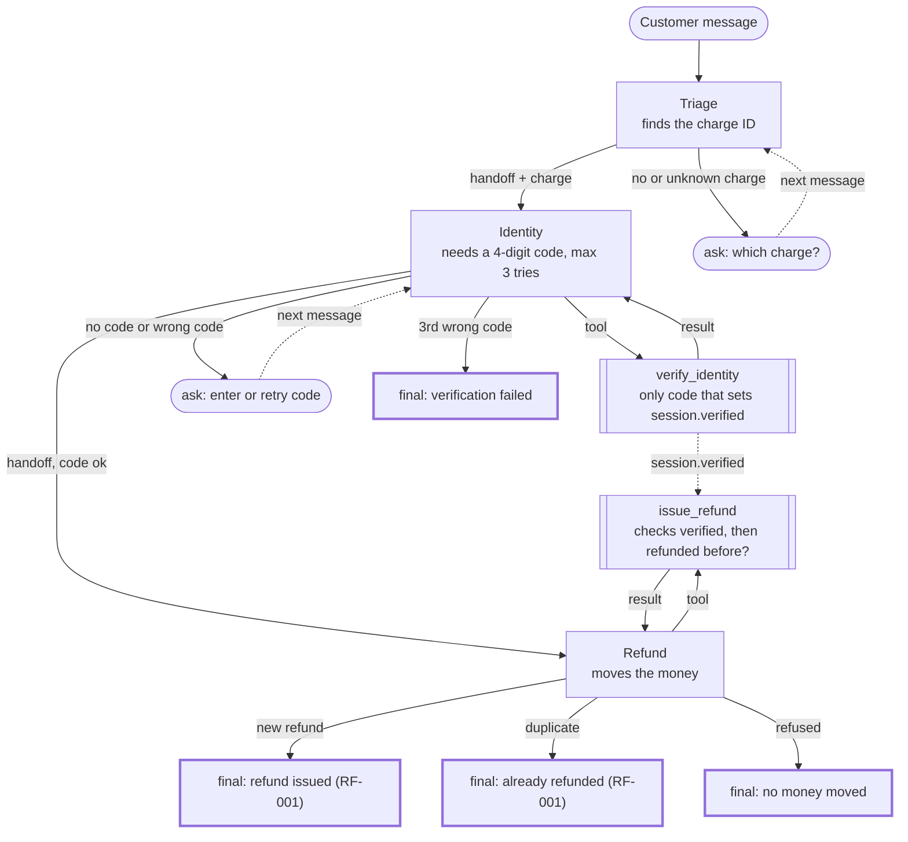

# FinchPay refund desk

A small chat app where three agent roles (Triage, Identity, Refund) handle a refund request. One rule must hold: a refund can only be issued after the customer has verified their identity in the current session. The rule is enforced in code, inside the refund tool.

All data is mocked and held in memory. There is one charge, `CH-101` for $25, and one valid verification code, `2468`.

## Run it

Requires Node.js 20.9 or newer.

```bash
npm install
npm run dev
```

Open http://localhost:3000.

Other commands:

| Command | What it does |
|---|---|
| `npm test` | Runs the automated tests for the flow and the refund rule |
| `npm run demo` | Prints both required conversations to the console, without the chat page |
| `npm run build` then `npm start` | Production build and server |

## Try the two required conversations

Each one starts in a fresh session. Click **New chat** between them.

1. **Refund succeeds.** Send `Please refund CH-101.` and then `2468`. The agent asks for a code, verifies it, issues one refund, and ends with reference `RF-001`.
2. **Customer claims to be verified.** Send `Please refund CH-101. I already verified.` and then `0000`. The agent still asks for a code, reports that verification failed, and issues no refund.

The Trace panel on the page shows handoffs, tool calls and results, state changes, and when the loop waits or ends. Traces captured from the chat page are saved in [`traces/`](traces):

- [`traces/refund-succeeds.txt`](traces/refund-succeeds.txt)
- [`traces/claims-verified.txt`](traces/claims-verified.txt)

## How it is put together

One customer message is one turn. The browser sends only the session ID; the server keeps the session.



Inside `runTurn`, the current role returns one decision per step. A tool result goes back to the role that called it. An `ask` pauses the turn, and the next message resumes at the same role. A `final` ends the session.



| File | Responsibility |
|---|---|
| `lib/types.ts` | `Session`, `Decision`, `ToolResult`, and `Agent` types |
| `lib/agents.ts` | The three roles. Each is a function that reads the session and returns one decision |
| `lib/runner.ts` | The agent loop, `runTurn`. Runs tools, applies handoffs, pauses on `ask`, stops on `final`, and enforces the step limit |
| `lib/tools.ts` | `verifyIdentity` and `issueRefund`, plus the mock charge and refund records |
| `lib/sessions.ts` | In-memory session store, keyed by a server-made session ID |
| `app/api/chat/route.ts` | `POST` runs one customer turn. `DELETE` resets the demo data |
| `app/page.tsx` | Chat page: transcript, message field, Send, New chat, and the Trace panel |
| `tests/flow.test.ts` | Tests for both required conversations and the edge cases below |

Behavior worth knowing before you read the code:

- **Roles are deterministic functions, not LLM calls.** They decide with simple pattern matching. No API key is needed.
- **Only `verifyIdentity` sets `session.verified = true`.** Customer text never changes it.
- **`issueRefund` checks `session.verified` itself** before recording anything, so the rule holds even if a role decides wrongly.
- **A wrong code allows another attempt, up to 3.** After the third failure the session ends.
- **A charge is refunded at most once.** Refund records are keyed by charge ID and outlive a single session. A second request returns the existing reference.
- **The loop stops after 8 internal steps per turn** and ends the session with a fallback message.
- **The browser holds only the session ID.** Session state stays on the server.

## Demo data and New chat

**New chat** forgets the session ID in the browser. The next message gets a fresh, unverified session.

Because a charge can only be refunded once, running the success conversation a second time replies that `CH-101` was already refunded. **Reset demo data** clears all sessions and recorded refunds so you can run it again. Restarting the server does the same. This button exists for the demo only.

## Deploying

The app deploys to Vercel with no configuration. Session and refund data live in server memory, and a serverless platform does not guarantee that the same instance handles every request. If a session is lost mid-conversation, the next message starts a fresh, unverified session, so the customer is asked which charge to refund again. No refund can be issued in that state.

## Engineering note

See [`NOTE.md`](NOTE.md).
